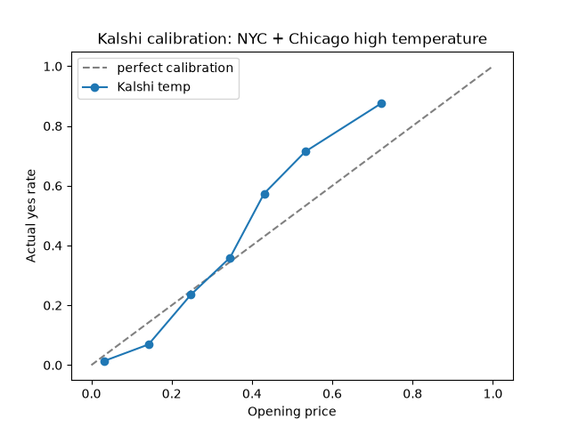

# Kalshi Calibration
Kalshi, along with many other prediction markets operate in a system similar to this: at a 30¢, the traders are saying there is a 30% chance. This project will test whether if this is true by analyzing thousands of settled markets across Kalshi, and these observations will get visualized as charts where perfectly calibrated markets fall right on the diagonal line.

## Results

Across 408 settled NYC high-temperature markets, cheap contracts (under 40¢) won less often than their price implied, and 40–60¢ favorites won more often. That's a classic favorite-longshot bias. Buckets above 60¢ have fewer than 5 markets each, so they aren't reliable yet.